# Art Gallery API

แกลเลอรี React + Vite พร้อม REST API ที่เขียนด้วย Node.js + Express.js และใช้ไฟล์ JSON เป็นฐานข้อมูลชั่วคราว

## ข้อแนะนำจากงานแรก → สิ่งที่แก้

| ข้อแนะนำจากงานแรก | สิ่งที่แก้ในงานนี้ | หลักฐาน Before / After |
|---|---|---|
| อาจารย์แนะนำ: “ทำช่อง Sorting ให้ขนาดเท่ากับช่องอื่น” | Sort มี label “Sort by” และ dropdown ใช้สไตล์ร่วมกับ Category ทั้งความกว้าง ความสูง และพื้นผิว ดูที่ `frontend/src/App.jsx:512–515` และ `frontend/style.css:754–781` ซึ่งกำหนด `.sort-box` และใช้กฎร่วม `.filter-box select, .sort-box select` | Before:<br>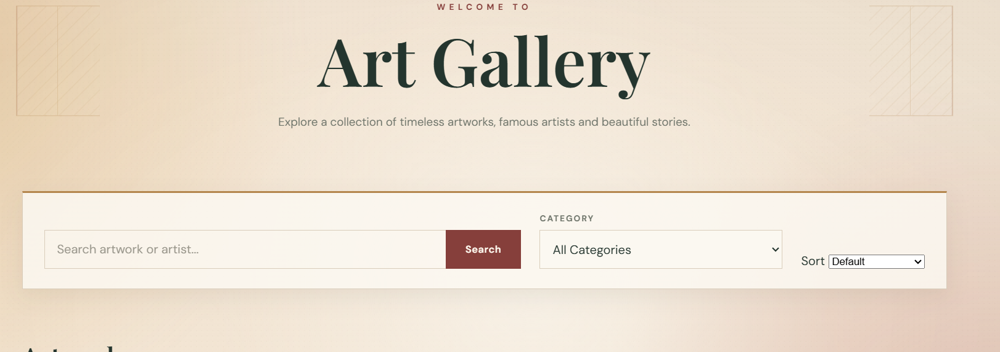<br>After:<br>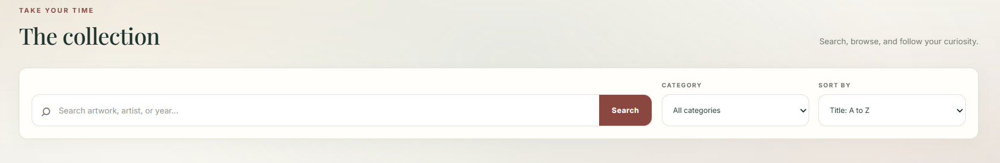 |
| อาจารย์แนะนำ: “เพิ่มฟังก์ชัน Clear all สำหรับส่วน Viewing” | เพิ่ม Clear all ใน Recently viewed (`frontend/src/App.jsx:578–580`), Viewing queue (`:589–590`) และ Favorites (`:598`) พร้อมปุ่มลบรายรายการและรูปย่อผ่าน `ListItem` (`:583–600, :646–653`) | Before (Recently viewed):<br>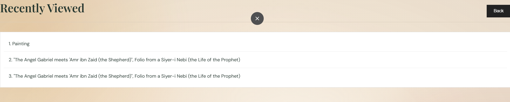<br>Before (Viewing queue):<br>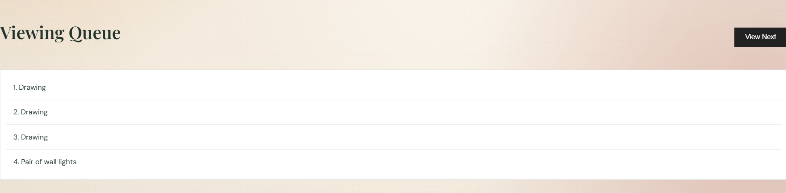<br>After:<br>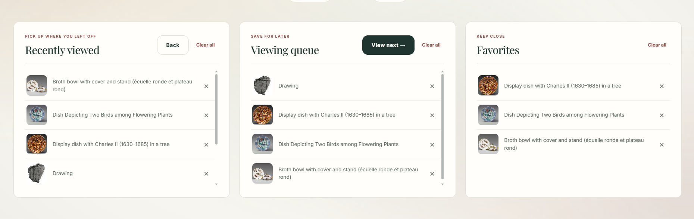 |
| อาจารย์แนะนำ: “ทำหน้าเว็บให้สวยขึ้น” | ปรับหน้าตาและโครงสร้างเป็น React + Vite แบบ Single-page application โดยแยก UI เป็น React components; การ์ดอยู่ใน `frontend/src/App.jsx:540–565` และ `frontend/style.css:874–900`, ส่วน modal อยู่ใน `frontend/src/App.jsx:619–629` และ `frontend/style.css:1266–1320` มีการใช้มุมโค้ง ฟอนต์หัวข้อ และรูปแบบปุ่ม/สีตาม stylesheet **หมายเหตุ:** โค้ดปัจจุบันเป็นหน้าเดียวที่มีส่วน Collection และ Your Visit ไม่ใช่หลายหน้าแยกกัน | Before (การ์ด):<br>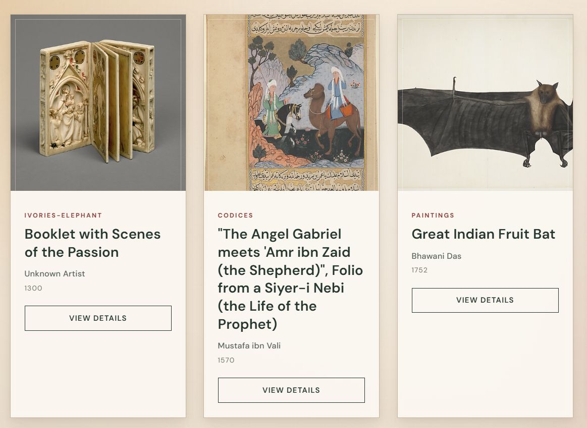<br>Before (modal):<br>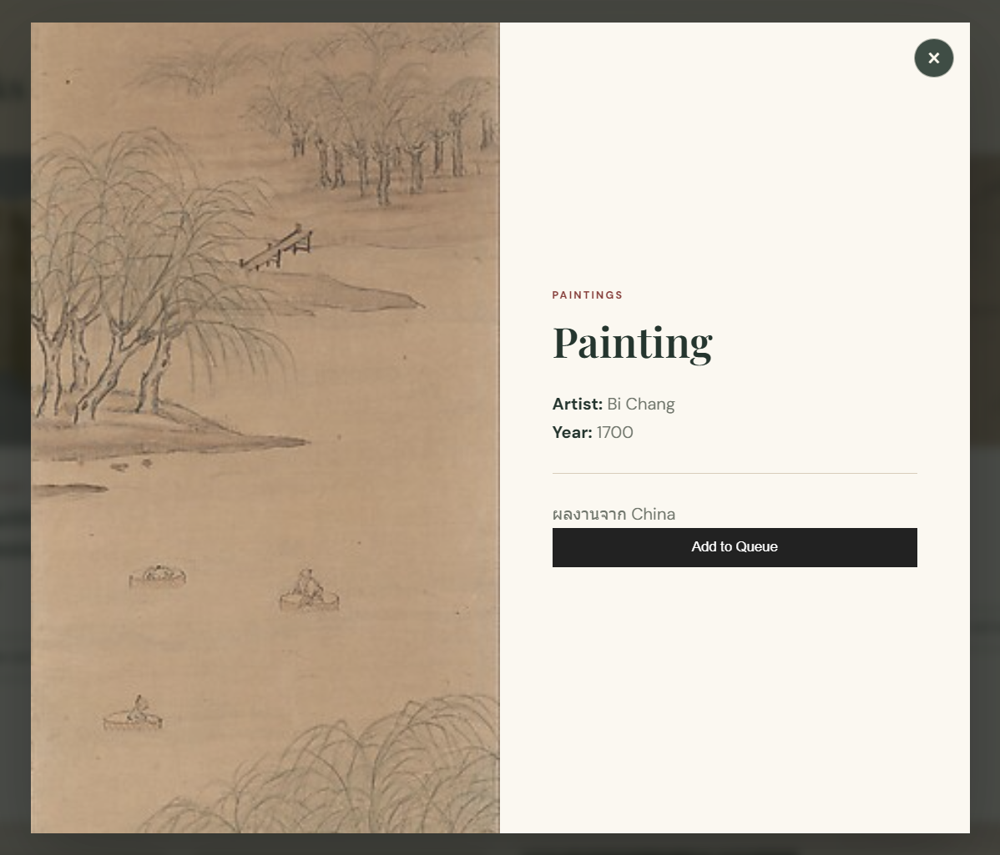<br>After (การ์ด):<br>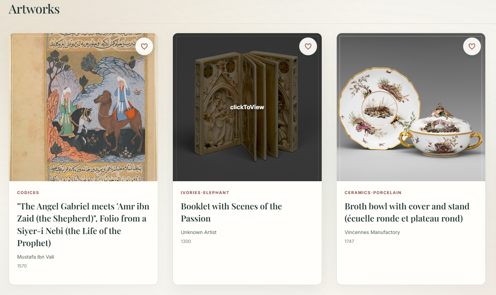<br>After (modal):<br>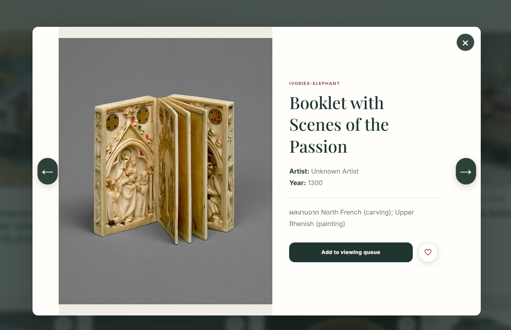 |
| อาจารย์แนะนำ: “เพิ่มฟังก์ชันให้ผู้ใช้ให้น่าสนใจขึ้น” | เพิ่ม Favorites ด้วยปุ่มหัวใจ (`frontend/src/App.jsx:555–556, :390–395`), ปุ่มดูชิ้นก่อน/ถัดไปใน modal (`:626–627, :329–359`), Search Suggestions (`frontend/searchUtils.js:6–68`, `frontend/src/App.jsx:303–306, :489–495`), สลับภาษา EN/TH (`frontend/src/App.jsx:435`), ส่วน Your Visit (`:577–603`), บันทึกสถานะลง `localStorage` (`:186–198`) และ skeleton ระหว่างโหลด (`:534–535`; รูปแบบอยู่ใน `frontend/style.css:813–853`) | Before:<br><br>After (modal):<br><br>After (การ์ด):<br> |
| (เพิ่มเอง — ไม่ได้อยู่ในคำแนะนำของอาจารย์) ค้นหาครอบคลุมขึ้น | การกรองหลักใน `frontend/src/App.jsx:275–281` ค้นจากชื่อผลงาน ศิลปิน หมวดหมู่ ปี และข้อมูลประเทศ/วัฒนธรรม/คำอธิบาย; Search Suggestions ใช้ `frontend/searchUtils.js:6–68` ช่องค้นหาอยู่ที่ `frontend/src/App.jsx:473–484` และเป็น `type="search"` ซึ่งรองรับปุ่มล้างของเบราว์เซอร์ (ไม่มีปุ่ม ✕ แบบกำหนดเองในโค้ด) Placeholder ปัจจุบันคือ “Search artwork, artist, year, or country...” ไม่ใช่ข้อความที่ละประเทศ; ตรวจจากชุดข้อมูลและเงื่อนไขค้นหาปัจจุบันแล้ว คำว่า “china” ตรงกับ 3 ผลงาน | Before:<br>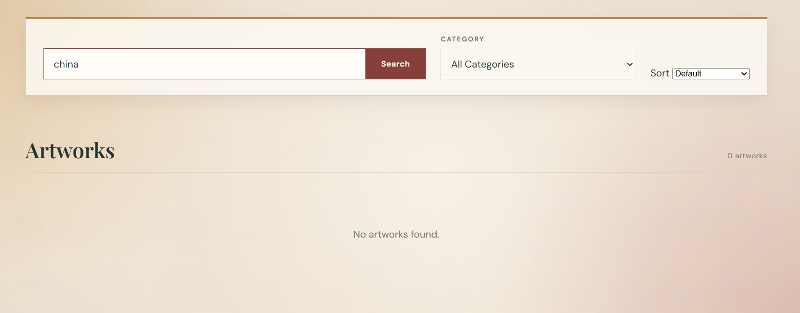<br>After:<br>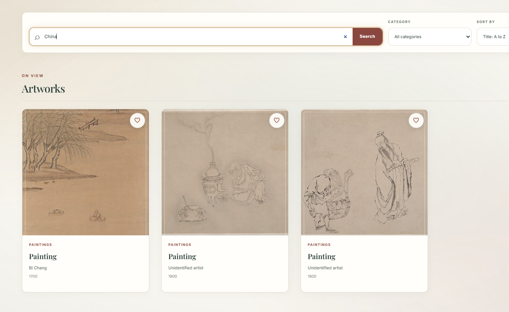 |

## โครงสร้างโปรเจกต์

```
art-gallery-api/
├── backend/
│   ├── controllers/
│   │   └── artworkController.js
│   ├── data/
│   │   ├── artworkStore.js    # Atomic write, file lock และ CRUD marker
│   │   └── artworks.json      # ฐานข้อมูลชั่วคราวแบบไฟล์ JSON
│   ├── middleware/
│   │   ├── artworkStorageMode.js
│   │   └── errorHandler.js
│   ├── routes/
│   │   └── artworkRoutes.js   # กำหนดเส้นทาง (routes) ทั้งหมดของ artwork
│   ├── services/
│   │   ├── metMuseumApi.js    # Met API client, timeout/retry/concurrency/validation
│   │   └── metMuseumSync.js   # ตรวจและเขียนข้อมูล Sync แบบ atomic
│   ├── tests/
│   │   ├── artworkApi.test.js # API integration tests ใช้สำเนา Dataset ชั่วคราว
│   │   └── metMuseumApi.test.js # Met API mock tests และ isolated sync tests
│   └── server.js              # Express API และ static server
├── frontend/
│   ├── src/                   # React application
│   ├── tests/                 # Frontend utility tests
│   ├── index.html             # Vite entry point
│   ├── searchUtils.js         # Search suggestions utility
│   ├── script.js              # Existing frontend script
│   └── style.css              # gallery styling
├── frontend-dist/             # Vite production build
├── vite.config.js             # Vite config และ /api proxy
├── vercel.json                # Vercel deployment config
├── package.json
├── package-lock.json
├── DECISION_LOG.md
├── .gitignore
└── README.md
```

## 🚀 วิธีเริ่มต้นและรันโปรเจกต์ (Getting Started / Running the App)

### ⚠️ ตรวจสอบตำแหน่งโฟลเดอร์ก่อน

โปรเจกต์นี้แบ่งเป็น 2 ส่วน คือ `backend` และ `frontend` หากแตกไฟล์ ZIP แล้วพบว่ามีโฟลเดอร์โปรเจกต์ซ้อนกัน ให้เข้าไปยังโฟลเดอร์ชั้นในที่มีทั้ง `backend`, `frontend` และ `package.json` อยู่ด้วยกันก่อน

```bash
# ตัวอย่าง: เข้าไปยังโฟลเดอร์โปรเจกต์ที่ถูกต้อง
cd art-gallery-api

# ตรวจสอบว่ามีโฟลเดอร์และ package.json อยู่ในตำแหน่งนี้
dir
# หรือ
ls
```

> **หมายเหตุ:** ในโปรเจกต์นี้ `package.json` และ dependencies อยู่ที่โฟลเดอร์หลัก ไม่ได้แยกอยู่ใน `backend` และ `frontend` ดังนั้นให้ติดตั้งแพ็กเกจจากโฟลเดอร์หลักเพียงครั้งเดียว และอย่ารัน `npm install` ภายในโฟลเดอร์ย่อย

### 📦 ติดตั้ง dependencies

เปิด Terminal ที่โฟลเดอร์หลักของโปรเจกต์ (โฟลเดอร์ที่มี `package.json`) แล้วรัน:

```bash
npm install
```

### 🖥️ รัน Backend

เปิด Terminal หน้าต่างแรก โดยให้ตำแหน่งอยู่ที่โฟลเดอร์หลักของโปรเจกต์ แล้วเริ่ม Backend:

```bash
npm run dev:backend
```

Backend จะทำงานที่ `http://localhost:3000` และให้เปิด Terminal นี้ค้างไว้

### 🌐 รัน Frontend

เปิด Terminal **อีกหน้าต่างหนึ่ง** และตรวจสอบให้แน่ใจว่าอยู่ที่โฟลเดอร์หลักของโปรเจกต์เช่นกัน จากนั้นเริ่ม Frontend:

```bash
npm run dev:frontend
```

เปิด URL ที่ Vite แสดงใน Terminal (โดยปกติคือ `http://localhost:5173`) โดยให้ Backend ยังทำงานอยู่ใน Terminal แรก

### 🔧 หากพบ Error `ENOENT: no such file or directory, open 'package.json'`

Error นี้มักหมายถึง Terminal อยู่ผิดโฟลเดอร์ หรืออยู่ใน `backend`/`frontend` ซึ่งไม่มี `package.json` ให้พิมพ์ `dir` (Windows) หรือ `ls` เพื่อดูตำแหน่งปัจจุบันและรายการไฟล์ จากนั้นใช้ `cd` กลับไปยังโฟลเดอร์หลักที่มี `package.json`, `backend` และ `frontend` แล้วลองใหม่

```bash
dir
# หรือ
ls

# ตัวอย่าง: กลับไปยังโฟลเดอร์หลักของโปรเจกต์
cd ..
```

### 📦 รันแบบ Production

หากต้องการ Build Frontend แล้วเริ่ม Express API และเว็บไซต์ด้วยคำสั่งเดียว ให้รันจากโฟลเดอร์หลัก:

```bash
npm start
```

โดยปกติ Backend ใช้ `backend/data/artworks.json` ที่มีอยู่และไม่ซิงก์ทับข้อมูลอัตโนมัติ หากต้องการสั่งซิงก์จาก Met API ตอนเริ่ม Backend โดยตั้งใจ ให้ใช้ `SYNC_ARTWORKS_ON_START=true npm run dev:backend` การแก้ไขหรือลบข้อมูลผ่าน CRUD จะสร้างไฟล์ `artworks.json.crud-modified` เพื่อป้องกันการซิงก์ครั้งต่อไปเขียนทับข้อมูลเหล่านั้น

Met API ใช้ paginated Search endpoint `/public/collection/v1.1/search` และ Object endpoint `/public/collection/v1/objects/{id}` ตาม [เอกสาร Met API](https://metmuseum.github.io/); Search ส่ง `offset`/`limit` (ไม่เกิน 500) เพราะ endpoint `/v1/search` เดิมถูกเลิกใช้งานแล้ว Client จำกัดพร้อมกัน 4 requests, timeout 15 วินาที และ retry สูงสุด 2 ครั้งเฉพาะ network/timeout, HTTP 429 และ 5xx โดยเคารพ `Retry-After` สูงสุด 30 วินาทีต่อการรอ หาก API ล้มเหลว, ไม่พบข้อมูล หรือได้ response ไม่ครบ ระบบจะคง Dataset เดิมไว้และ Express ยังให้บริการไฟล์นั้นต่อ

`npm start` ให้บริการทั้งเว็บไซต์และ API ที่:
```
http://localhost:3000
```

Frontend กลับมาเป็นหน้าเดียวแบบเดิม โดยเมนูและปุ่มบน Hero ใช้ in-page anchor ไปยังส่วน Collection และ Your Visit:
```
http://localhost:3000/#top
http://localhost:3000/#collection
http://localhost:3000/#your-visit
```

หน้า Home, Collection และ Your Visit แสดงต่อเนื่องในเอกสารเดียว ไม่มี React Router หรือ Graph navigation; Favorites, Recently Viewed และ Viewing Queue ยังคงเก็บใน LocalStorage ของ browser

Vite dev server ใช้ `http://localhost:5173` และ proxy `/api` ไปยัง Express ที่พอร์ต 3000 สามารถเปลี่ยนพอร์ต API proxy ได้ด้วย `API_PORT` หรือกำหนด `API_PROXY_TARGET` โดยตรง สคริปต์เดิม `npm run dev:api` ยังคงใช้ได้และชี้ไปยัง Backend ตัวเดียวกัน

ตรวจสอบ production build และ tests ได้ด้วย `npm run build` และ `npm test` โดย build จะเขียนไฟล์ไว้ใน `frontend-dist/`

Backend integration tests ใน `backend/tests/artworkApi.test.js` ครอบคลุมทั้ง 6 routes, query ซ้ำ, ID และ PUT ที่ไม่ถูกต้อง, JSON เสียรูปแบบ, concurrent/atomic writes, การกัน Met Sync เขียนทับหลัง CRUD และโหมด read-only ของ Vercel โดยคัดลอก Dataset ไปยัง temporary directory ก่อนทดสอบ และตรวจว่าไฟล์จริงไม่เปลี่ยน การทดสอบ Met Sync ใช้ฟังก์ชันจัดเก็บหลัง Sync โดยตรง ไม่เรียก Met API ภายนอก

## เอกสารใบงาน 3.1–3.4: React State, Effects, Components และ Navigation

เอกสารส่วนนี้ตรวจจาก React entry point ที่ `frontend/src/main.jsx` และ source files ใน `frontend/src/`: [App.jsx](./frontend/src/App.jsx) และ [main.jsx](./frontend/src/main.jsx) โดย State ของแอปยังอยู่ใน `App`; มี Effect 15 จุดใน `App` และอีก 1 จุดใน `BackgroundFX` รวม 16 จุด

### ข้อ 3.1 — useState

`App` ประกาศ State 25 ตัว แต่ละตัวมี setter และเปลี่ยนค่าเมื่อมีการโต้ตอบหรือ Effect ที่เกี่ยวข้องดังตาราง:

| State | ข้อมูลที่เก็บ | Component/พื้นผิวที่ใช้ | ผู้เปลี่ยนค่า | เหตุผลที่ต้องเป็น State |
|---|---|---|---|---|
| `artworks` | รายการผลงานจาก API | `App` / Collection, Search Suggestions, Artwork Card, Modal | `setArtworks` เมื่อ `/api/artworks` โหลดสำเร็จ | ข้อมูลจาก API เปลี่ยนได้ และต้อง render รายการใหม่ |
| `searchQuery` | คำค้นหา | `App` / Search | `setSearchQuery` จาก `onChange` ของช่องค้นหา | ควบคุมผลกรองและ Search Suggestions |
| `selectedCategory` | หมวดหมู่ที่เลือก (`all` เป็นค่าเริ่มต้น) | `App` / Category Filter | `setSelectedCategory` จากตัวเลือกหมวดหมู่ หรือเลือก Suggestion | ใช้กรองผลงานและสะท้อนตัวเลือกใน UI |
| `sortOrder` | วิธีเรียง เช่น `title-asc`, `year-desc` | `App` / Sorting | `setSortOrder` จากตัวเลือก Sort | เปลี่ยนลำดับผลงานและ render ผลใหม่ |
| `currentPage` | หน้าปัจจุบัน (เริ่มที่ 1) | `App` / Pagination | `setCurrentPage` จากปุ่มก่อนหน้า/ถัดไป; Effect คืนเป็น 1 เมื่อ filter เปลี่ยน | เก็บหน้าที่ผู้ใช้กำลังดู |
| `loading` | สถานะโหลดข้อมูลหรืออัปเดตผล | `App` / Collection loading UI | `setLoading` ใน Effect โหลด API และ Effect หน่วง 120 ms หลังตัวกรองเปลี่ยน | เลือกแสดง skeleton, loading message หรือผลงาน |
| `error` | ข้อความผิดพลาดจากการโหลด API หรือ `null` | `App` / Collection error UI | `setError` ใน Effect โหลด API; retry จะล้างค่าเมื่อเริ่มโหลดใหม่ | แสดงข้อผิดพลาดและปุ่มลองใหม่ |
| `recentlyViewed` | Array ประวัติที่เรียงรายการล่าสุดไว้ด้านหน้า (สูงสุด 40 ชิ้น) | `App` / Your Visit, Artwork Modal | `setRecentlyViewed` ใน `addToRecentlyViewed`, Back, Remove และ Clear All | เก็บประวัติสำหรับเปิดซ้ำและย้อนดู; ใช้ร่วมกันระหว่างหน้าและบันทึกใน LocalStorage |
| `viewingQueue` | Queue ของผลงานที่รอเข้าชม | `App` / Your Visit, Artwork Modal | `setViewingQueue` ใน Add to Queue, View Next, การเดิน Modal ใน Queue, Remove และ Clear All | รักษาลำดับคิวข้ามหน้าและระหว่างเปิด Modal; บันทึกใน LocalStorage |
| `favorites` | รายการผลงานโปรด | `App` / Artwork Cards, Modal, Your Visit | `setFavorites` ใน `toggleFavorite` และ Clear All; ค่าเริ่มต้นอ่านจาก `artGalleryFavorites` | ให้สถานะ Favorite ตรงกันทุกพื้นผิวและคงอยู่หลัง refresh |
| `language` | ภาษาปัจจุบัน `en` หรือ `th` | `App` / ทุกข้อความและเมนู | `setLanguage` จาก Language Toggle; ค่าเริ่มต้นอ่านจาก LocalStorage | render คำแปลและตั้ง `document.documentElement.lang` |
| `selectedArtwork` | Artwork ที่กำลังเปิดใน Modal หรือ `null` | `App` / Artwork Modal | `setSelectedArtwork` ใน `openArtwork`, การเลื่อนผลงาน, Back และการปิด Modal | ควบคุมเนื้อหาและการแสดง/ซ่อนรายละเอียด |
| `selectedArtworkId` | ID ที่ Search Suggestion เลือก หรือ `null` | `App` / Collection | `setSelectedArtworkId` ใน `selectSuggestion`; ล้างเมื่อค้นหา/เปลี่ยน filter/sort/submit | ระบุ artwork เป้าหมายให้ Effect พยายามเลื่อน/ไฮไลต์เมื่อ Card ของชิ้นนั้นอยู่ใน DOM |
| `suggestionsOpen` | สถานะเปิด Search Suggestions | `App` / Search Suggestions | `setSuggestionsOpen` จาก focus, change, เลือก suggestion และ submit | ควบคุมการแสดงรายการคำแนะนำ |
| `searchFocused` | สถานะ focus ของช่องค้นหา | `App` / Search Focus styling | `setSearchFocused` จาก focus, blur, เลือก suggestion และ submit | ควบคุม class บน `body` และรูปแบบเมื่อกำลังค้นหา |
| `toast` | ข้อความแจ้งเตือน พร้อม `type` และ `key` หรือ `null` | `App` / Toast | `setToast` ใน `showToast`; Effect ล้างหลัง 2,200 ms | แสดงผลตอบรับชั่วคราว เช่น เพิ่มรายการหรือรายการซ้ำ |
| `reloadKey` | ตัวนับสำหรับสั่งโหลด API ใหม่ | `App` / ปุ่ม Try again | `setReloadKey` เพิ่มค่าเมื่อกด Retry | ใช้เป็น dependency ให้ Effect โหลดข้อมูลเริ่มทำงานใหม่ |
| `modalSource` | แหล่งรายการ Modal (`collection` หรือ `queue`) | `App` / Artwork Modal | `setModalSource` ใน `openArtwork` และ `goBackArtwork` | กำหนดว่าปุ่มก่อนหน้า/ถัดไปเดินใน Collection หรือ Queue |
| `modalIndex` | ตำแหน่ง Artwork ในรายการ Modal | `App` / Artwork Modal | `setModalIndex` ใน `openArtwork`, `navigateModal`, `goBackArtwork` | คำนวณปุ่มก่อนหน้า/ถัดไปและ artwork ปัจจุบัน |
| `queueSequence` | ลำดับ Queue ที่กำลังเดินใน Modal | `App` / Artwork Modal | `setQueueSequence` เมื่อเปิด artwork จาก Queue, ข้ามไปชิ้นถัดไป หรือออกจาก Queue mode | เก็บลำดับที่ผ่านใน modal เพื่อรองรับการเดินรายการ |
| `highlightedArtworkId` | ID ของ Card ที่ต้องไฮไลต์ชั่วคราว | `App` / Artwork Card | Effect เมื่อเลือก Suggestion; ตั้งกลับเป็น `null` หลัง 2,800 ms | แสดงตำแหน่งผลค้นหาที่เลือก |
| `scrollY` | ตำแหน่ง scroll แนวตั้งปัจจุบัน | `App` / Scroll-to-top button | `setScrollY` จาก `scroll` event | แสดงปุ่มเลื่อนขึ้นเมื่อ scroll เกิน 360 px |
| `introPhase` | สถานะ Intro (`loading`, `exiting`, `done`); เริ่มเป็น `done` เมื่อเปิด `prefers-reduced-motion` | `App` / Intro นอก `<Routes>` | Timer ใน Effect Intro | ควบคุมลำดับ animation; Intro แสดงเมื่อโหลดหน้าใหม่ แต่ไม่เริ่มซ้ำเมื่อเปลี่ยน route |
| `introProgress` | ความคืบหน้า Intro 0–100 | `App` / Intro progress bar | Interval ใน Effect Intro ทุก 50 ms ตลอด 950 ms และตั้งเป็น 100 เมื่อจบ | อัปเดตค่า progress บน UI |
| `heroRevealed` | Hero animation แสดงแล้วหรือยัง; เริ่มเป็นจริงถ้าข้าม Intro | `App` / Home Hero | เริ่มต้นจากสถานะ reduced motion; timer จบ Intro เรียก `setHeroRevealed(true)` หลังประมาณ 1,300 ms | เลือก class สำหรับ animation ของข้อความ Hero |

ตำแหน่งประกาศ State อยู่ใน `App` ใน [App.jsx](./frontend/src/App.jsx); ไม่มี `useState` ใน `VisitPanel` หรือ `ListItem` State ที่ใช้ร่วมกันระหว่าง Header, Collection, Your Visit และ Modal จึงอยู่ที่ `App` ส่วนค่าที่เป็นผลคำนวณ เช่น `filteredArtworks`, `categories` และ `suggestions` ใช้ `useMemo` ไม่ได้เก็บเป็น State เพิ่มเติม

หมายเหตุเกี่ยวกับโครงสร้างข้อมูล: Recently Viewed เป็น Array ที่เรียงรายการล่าสุดไว้ด้านหน้า ไม่ใช่คลาส Stack; `goBackArtwork` เลือกรายการ index 1 แล้วตัดรายการปัจจุบันออกด้วย `slice(1)` ส่วน `selectionSort` เป็นฟังก์ชันใน `App.jsx` ที่ใช้เรียง `filteredArtworks` ไม่ใช่ State หรือ Effect

### ข้อ 3.2 — useEffect

ใน `App` มี `useEffect` 15 จุด และใน `BackgroundFX` มี 1 จุด รวมทั้งหมด 16 จุด ไม่มี Effect ใน `VisitPanel` หรือ `ListItem` คำว่า “หลัง render” ในตารางหมายถึงหลัง React commit render ที่ mount หรือหลัง dependency เปลี่ยน:

| # | Component | Effect ทำอะไร | Dependency Array | ทำงานตอนไหน | Cleanup ที่มีในโค้ด |
|---:|---|---|---|---|---|
| 1 | `App` | โหลด `/api/artworks`; ตั้ง loading/error, ตรวจ response และ retry เมื่อ API แจ้ง syncing (`503`) หรือ network error | `[reloadKey]` | หลัง mount และเมื่อ Retry เปลี่ยน `reloadKey` | ตั้ง `cancelled = true` เพื่อไม่ให้ flow ที่ยกเลิกแล้วแก้ State; ไม่ได้ abort fetch โดยตรง |
| 2 | `App` | แสดง loading ชั่วคราวเมื่อเงื่อนไขค้นหา/กรอง/เรียงเปลี่ยน | `[searchQuery, selectedCategory, sortOrder]` | หลัง dependency เปลี่ยน; ทำงานต่อเมื่อ `hasLoaded.current` เป็นจริง | `clearTimeout(timer)` |
| 3 | `App` | บันทึก Favorites | `[favorites]` | หลัง mount และทุกครั้งที่ Favorites เปลี่ยน | ไม่มี |
| 4 | `App` | บันทึก Recently Viewed | `[recentlyViewed]` | หลัง mount และทุกครั้งที่ Array ประวัติเปลี่ยน | ไม่มี |
| 5 | `App` | บันทึก Viewing Queue | `[viewingQueue]` | หลัง mount และทุกครั้งที่ Queue เปลี่ยน | ไม่มี |
| 6 | `App` | บันทึกภาษาและกำหนด `document.documentElement.lang` | `[language]` | หลัง mount และเมื่อสลับภาษา | ไม่มี |
| 7 | `App` | เพิ่ม/เอา class `modal-open` บน `document.body` | `[selectedArtwork]` | หลังเปิด/ปิด artwork Modal | ลบ class `modal-open` |
| 8 | `App` | เพิ่ม/เอา class `search-focused` บน `document.body` | `[searchFocused]` | หลัง focus/blur ช่องค้นหาและการปิด suggestions ที่เปลี่ยนสถานะ focus | ลบ class `search-focused` |
| 9 | `App` | เพิ่ม/เอา class `intro-open` ตาม Intro phase เพื่อล็อก/ปลดการเลื่อนหน้า | `[introPhase]` | หลัง mount และเมื่อ Intro phase เปลี่ยน; ล็อกเฉพาะขณะที่ Intro ทำงาน | ลบ class `intro-open` |
| 10 | `App` | สมัคร `scroll` listener เพื่ออัปเดต `scrollY` | `[]` | ครั้งเดียวหลัง mount | `removeEventListener("scroll", onScroll)` |
| 11 | `App` | ถ้าไม่ได้เปิด reduced motion: อัปเดต progress ทุก 50 ms, เริ่ม exit ที่ 950 ms และจบ/เผย Hero ที่ประมาณ 1,300 ms | `[]` | ครั้งเดียวเมื่อ `App` mount ใหม่ (โหลด/รีเฟรชหน้า); ไม่ทำซ้ำเมื่อเปลี่ยน route เพราะ Intro อยู่นอก `<Routes>` | ล้าง interval และ timeout ทั้งสอง |
| 12 | `App` | พยายามเลื่อนไปยัง Card ที่ตรงกับ Suggestion และไฮไลต์เมื่อ Card มี ref อยู่ | `[selectedArtworkId, loading, artworks]` | เมื่อมี ID ที่เลือก, โหลดเสร็จ หรือรายการ artwork เปลี่ยน; ข้ามเมื่อไม่มี ID หรือยัง loading | ยกเลิก `requestAnimationFrame`; highlight timeout ไม่ได้ล้างใน cleanup นี้ |
| 13 | `App` | ซ่อน Toast หลัง 2,200 ms | `[toast]` | เมื่อ Toast เปลี่ยน; ไม่ตั้ง timer ถ้าไม่มี Toast | `clearTimeout(toastTimer.current)` |
| 14 | `App` | สมัครปุ่ม Escape/ลูกศรเมื่อ Modal เปิด | `[selectedArtwork, modalIndex, modalSource, queueSequence, viewingQueue]` | เมื่อ Modal หรือข้อมูลตำแหน่ง/รายการที่ใช้นำทางเปลี่ยน; ข้ามเมื่อไม่มี artwork ที่เลือก | `removeEventListener("keydown", onKeyDown)` |
| 15 | `App` | คืน Pagination ไปหน้า 1 เมื่อผลค้นหาหรือ filter/sort เปลี่ยน | `[searchQuery, selectedCategory, sortOrder, selectedArtworkId]` | หลัง mount และเมื่อ dependency ใดเปลี่ยน | ไม่มี |
| 16 | `BackgroundFX` | เมื่ออุปกรณ์รองรับ hover และไม่ลด motion: สมัคร `pointermove`, ไล่ตำแหน่ง spotlight ด้วย lerp และอัปเดต parallax ผ่าน CSS custom properties; หยุด RAF เมื่อแท็บซ่อนหรือค่าถึงเป้าหมาย | `[]` | ครั้งเดียวหลัง mount; ข้ามการสมัคร event บนอุปกรณ์สัมผัสหรือเมื่อเปิด `prefers-reduced-motion` | ยกเลิก `pointermove`/`visibilitychange` listeners และ `requestAnimationFrame` ที่ค้าง |

ตำแหน่ง Effect 1–15 อยู่ใน [App.jsx](./frontend/src/App.jsx); Effect 16 อยู่ใน [BackgroundFX.jsx](./frontend/src/components/BackgroundFX.jsx) และใช้ `useRef` เก็บ DOM element/ตำแหน่งเมาส์แทน `useState` เพื่ออัปเดต CSS variables โดยตรง ไม่ทำให้ component re-render ทุกครั้งที่ pointer ขยับ สำหรับ dependency `[]` React เรียก Effect ตอน mount เท่านั้น; cleanup ที่ระบุทำงานเมื่อ dependency เปลี่ยนหรือ component unmount ตาม lifecycle ของ React

### ข้อ 3.3 — Component Tree และ Props

`main.jsx` สร้าง React root โดยครอบ `App` ด้วย `StrictMode`; Home, Collection และ Your Visit เป็น sections ในหน้าเดียวและเขียน inline ภายใน `App`:

```text
main.jsx
└─ StrictMode
   └─ App                         owns all 25 State and 15 Effects
      ├─ BackgroundFX             owns 1 mount-only pointer/visibility Effect; keeps pointer values in refs
      ├─ Header (inline; Logo and in-page navigation)
      ├─ Main
      │  ├─ Hero
      │  ├─ Collection (Search, Suggestions, Filter, Sorting, Cards, Pagination)
      │  └─ Your Visit
      │     ├─ VisitPanel: Recently Viewed
      │     │  └─ ListItem*
      │     ├─ VisitPanel: Viewing Queue
      │     │  └─ ListItem*
      │     └─ VisitPanel: Favorites
      │        └─ ListItem*
      ├─ Artwork Modal (inline; when selectedArtwork is set)
      ├─ Toast / Scroll-to-top (inline)
      └─ Footer
```

#### Props จากแม่ไปลูก และ Callback จากลูกกลับแม่

| ลูก | Props ที่ `App` ส่งให้ | Callback/ข้อมูลที่ไหลกลับ |
|---|---|---|
| `VisitPanel` | `eyebrow`, `title`, `action`, `children` | ไม่มี callback prop โดยตรง; `action` และ `children` เป็น JSX ที่ `App` สร้างและส่งลงไป |
| `ListItem` | `artwork`, `onOpen`, `onRemove`, `removeLabel` | `ListItem` เรียก `onOpen()` เมื่อกดรายการ และ `onRemove()` เมื่อลบ; callback ที่สร้างใน `App` เปิด Modal หรืออัปเดต Recently Viewed/Queue/Favorites |

ตัวอย่าง callback จริง: ในรายการ Recently Viewed, `onOpen={() => openArtwork(artwork)}` และ `onRemove={() => setRecentlyViewed(...)}` ถูกส่งให้ `ListItem`; ในรายการ Queue ใช้ `openArtwork(artwork, "queue")` และ `setViewingQueue(...)`; Favorites ใช้ `toggleFavorite(artwork)` ดูการประกอบ props ได้ใน [App.jsx](./frontend/src/App.jsx)

ส่วน Collection ยังเป็น JSX ภายใน `App` จึงเรียก handler โดยตรง เช่น Card เรียก `openArtwork`/`toggleFavorite`, Search เรียก `selectSuggestion` และ Pagination เรียก `setCurrentPage` ไม่ได้ส่งผ่าน custom child component เพิ่มเติม การวาง State ไว้ที่ `App` ทำให้ Header, Sections, Modal และ list panels ใช้ข้อมูล/handler ชุดเดียวกัน; `VisitPanel` กับ `ListItem` เป็น component สำหรับโครงสร้างและการนำเสนอ ไม่ได้ถือ State

### ข้อ 3.4 — Navigation

Navigation กลับมาเป็นหน้าเดียว ไม่มี Graph หรือ Route แยกหน้า เมนูหลักและ Hero CTA ใช้ in-page anchor ไปยัง `#top`, `#collection` และ `#your-visit`; เนื้อหาทั้งสามส่วนแสดงต่อเนื่องในเอกสารเดียว ดังนั้นส่วน adjacency list และ React Router ตามหัวข้อ Graph ในข้อ 3.4 จึง **ไม่มีใน source ปัจจุบัน** ตามคำขอให้คืนรูปแบบ UI เดิม

### สรุปผลตามข้อและหลักฐาน

| ข้อ | สถานะจาก source ปัจจุบัน | หลักฐาน/ข้อจำกัด |
|---|---|---|
| 3.1 `useState` | **ผ่านตามโค้ดที่ตรวจ** | พบ State 25 ตัวใน `App`; ตารางระบุข้อมูล ผู้เปลี่ยนค่า และเหตุผลครบ ไม่มี State ใน child components |
| 3.2 `useEffect` | **ผ่านตามโค้ดที่ตรวจ** | พบ Effect 16 จุดรวม: 15 ใน `App` และ 1 ใน `BackgroundFX`; ตารางระบุ component, dependency, จังหวะทำงาน และ cleanup | 
| 3.3 Component & Props | **ผ่านตามโครงสร้างที่มี** | มี tree และ Props/Callback จริงของ `VisitPanel`/`ListItem`; Home, Collection และ Your Visit เป็น sections ในหน้าเดียว ไม่ใช่ page components แยก |
| 3.4 Graph/Navigation | **ไม่มี/ไม่ผ่านใน source ปัจจุบัน** | Navigation ใช้ in-page anchors ในหน้าเดียว; ไม่ได้ใช้ Graph adjacency list หรือ React Router |

**สิ่งที่ยังไม่มีหลักฐานอัตโนมัติ:** `npm test` ปัจจุบันครอบคลุม Search Suggestions 3 tests เท่านั้น ไม่มี component/integration tests แยกเพื่อยืนยันทุก State, Effect, Props หรือ Graph behavior; `npm run build` ยืนยันการ compile/build ไม่ได้ยืนยันพฤติกรรมเหล่านั้น นอกจากนี้ไม่มีเนื้อหาใบงานฉบับเต็มหรือ rubric สำหรับตรวจเงื่อนไขอื่นนอกเหนือจากข้อที่ระบุในคำขอนี้ ดังนั้นตารางเป็นการสำรวจและประเมินจาก source จริง ไม่ใช่ผลทดสอบอัตโนมัติหรือการรับรองจากผู้ตรวจงาน

## รายละเอียด API แต่ละ Endpoint

Base URL: `http://localhost:3000/api/artworks`

| Method | Endpoint | คำอธิบาย |
|--------|----------|----------|
| GET | `/api/artworks` | แสดงผลงานศิลปะทั้งหมด |
| GET | `/api/artworks/search?q=` | ค้นหาผลงานจาก title, artist, category หรือ year |
| GET | `/api/artworks/category/:category` | แสดงผลงานตาม category |
| GET | `/api/artworks/:id` | แสดงรายละเอียดผลงานตาม ID |
| PUT | `/api/artworks/:id` | แก้ไขข้อมูลผลงานศิลปะ |
| DELETE | `/api/artworks/:id` | ลบผลงานศิลปะ |

> **หมายเหตุ:** `/search` และ `/category/:category` ถูกจัดลำดับไว้ก่อน `/:id` ในไฟล์ routes เพื่อไม่ให้ Express เข้าใจผิดว่าคำว่า `search` หรือ `category` คือค่า id

---

### 1. GET /api/artworks

แสดงผลงานศิลปะทั้งหมด

**ตัวอย่าง Response (200 OK):**
```json
{
  "success": true,
  "total": 4,
  "data": [
    {
      "id": 1,
      "title": "The Starry Night",
      "artist": "Vincent van Gogh",
      "year": 1889,
      "category": "Painting",
      "description": "A famous painting depicting a night sky full of swirling stars over a small village.",
      "image": "https://example.com/starry-night.jpg"
    }
  ]
}
```

### 2. GET /api/artworks/:id

แสดงรายละเอียดผลงานศิลปะตาม ID

**ตัวอย่าง Request:** `GET /api/artworks/1`

**ตัวอย่าง Response (200 OK):**
```json
{
  "success": true,
  "data": {
    "id": 1,
    "title": "The Starry Night",
    "artist": "Vincent van Gogh",
    "year": 1889,
    "category": "Painting",
    "description": "A famous painting depicting a night sky full of swirling stars over a small village.",
    "image": "https://example.com/starry-night.jpg"
  }
}
```

**ถ้าไม่พบข้อมูล (404 Not Found):**
```json
{
  "success": false,
  "message": "ไม่พบผลงานศิลปะ id: 99"
}
```

### 3. PUT /api/artworks/:id

แก้ไขข้อมูลผลงานศิลปะตาม ID (ต้องส่ง `title` และ `artist` มาด้วย ห้ามเป็นค่าว่าง)

**ตัวอย่าง Request:** `PUT /api/artworks/1`

**ตัวอย่าง Request Body:**
```json
{
  "title": "The Starry Night (Updated)",
  "artist": "Vincent van Gogh",
  "year": 1889,
  "category": "Painting",
  "description": "คำอธิบายที่แก้ไขใหม่",
  "image": "https://example.com/starry-night.jpg"
}
```

**ตัวอย่าง Response (200 OK):**
```json
{
  "success": true,
  "message": "แก้ไขผลงานศิลปะสำเร็จ",
  "data": {
    "id": 1,
    "title": "The Starry Night (Updated)",
    "artist": "Vincent van Gogh",
    "year": 1889,
    "category": "Painting",
    "description": "คำอธิบายที่แก้ไขใหม่",
    "image": "https://example.com/starry-night.jpg"
  }
}
```

**ถ้าไม่พบข้อมูล:** ส่ง 404 (รูปแบบเดียวกับข้อ 2)
**ถ้าข้อมูลไม่ครบ:** ส่ง 400 (รูปแบบเดียวกับข้อ 3)

### 4. DELETE /api/artworks/:id

ลบผลงานศิลปะตาม ID

**ตัวอย่าง Request:** `DELETE /api/artworks/1`

**Response:** `204 No Content` (ไม่มี body ส่งกลับ)

**ถ้าไม่พบข้อมูล (404 Not Found):**
```json
{
  "success": false,
  "message": "ไม่พบผลงานศิลปะ id: 99"
}
```

### 5. GET /api/artworks/search?q=

ค้นหาผลงานจาก `title`, `artist`, `category` หรือ `year` (ไม่สนตัวพิมพ์เล็ก/ใหญ่)

**ตัวอย่าง Request:** `GET /api/artworks/search?q=van gogh`

**ตัวอย่าง Response (200 OK):**
```json
{
  "success": true,
  "total": 1,
  "data": [
    {
      "id": 1,
      "title": "The Starry Night",
      "artist": "Vincent van Gogh",
      "year": 1889,
      "category": "Painting",
      "description": "A famous painting depicting a night sky full of swirling stars over a small village.",
      "image": "https://example.com/starry-night.jpg"
    }
  ]
}
```

**ถ้าไม่ระบุ q (400 Bad Request):**
```json
{
  "success": false,
  "message": "กรุณาระบุคำค้นหาผ่าน query parameter 'q'"
}
```

### 6. GET /api/artworks/category/:category

แสดงผลงานตาม category (ไม่สนตัวพิมพ์เล็ก/ใหญ่)

**ตัวอย่าง Request:** `GET /api/artworks/category/Painting`

**ตัวอย่าง Response (200 OK):**
```json
{
  "success": true,
  "total": 3,
  "data": [
    { "id": 1, "title": "The Starry Night", "artist": "Vincent van Gogh", "category": "Painting", "...": "..." }
  ]
}
```

---

## วิธีทดสอบด้วย Postman

1. เปิดโปรแกรม Postman แล้วสร้าง Collection ใหม่ชื่อ `Art Gallery API`
2. ตั้งค่า Base URL เป็น `http://localhost:3000` (ต้องรันเซิร์ฟเวอร์ด้วย `npm start` ก่อน)
3. สร้าง Request ตามตารางด้านล่าง:

| ชื่อ Request | Method | URL |
|---|---|---|
| Get All Artworks | GET | `http://localhost:3000/api/artworks` |
| Get Artwork By Id | GET | `http://localhost:3000/api/artworks/1` |
| Search Artworks | GET | `http://localhost:3000/api/artworks/search?q=starry` |
| Get By Category | GET | `http://localhost:3000/api/artworks/category/Painting` |
| Update Artwork | PUT | `http://localhost:3000/api/artworks/1` |
| Delete Artwork | DELETE | `http://localhost:3000/api/artworks/1` |

4. สำหรับ **PUT**:
   - ไปที่แท็บ **Body** → เลือก **raw** → เลือกประเภทเป็น **JSON**
   - วาง JSON ตัวอย่าง เช่น:
     ```json
     {
       "title": "Mona Lisa",
       "artist": "Leonardo da Vinci",
       "year": 1503,
       "category": "Painting",
       "description": "A half-length portrait painting.",
       "image": "https://example.com/mona-lisa.jpg"
     }
     ```
5. กด **Send** แล้วดูผลลัพธ์ที่ส่วน Response ด้านล่าง ตรวจสอบทั้ง status code (200, 204, 400, 404) และ body ที่ได้กลับมา

## หมายเหตุ

- การแก้ไขและลบข้อมูลในเครื่องจะเขียนไฟล์ `backend/data/artworks.json` แบบ atomic และจัดลำดับการเขียนภายใน Node.js process เดียวกัน
- บน Vercel API อ่าน Dataset ที่มากับ Deployment แบบ read-only; `PUT` และ `DELETE` ตอบ `503` เพราะโปรเจกต์ยังไม่มี durable shared storage ห้ามถือว่า `/tmp` หรือ filesystem ของ serverless เป็นพื้นที่ถาวร
- หากต้องการ CRUD บน Vercel ต้องตั้งค่า storage ภายนอกที่รองรับการเขียนถาวรและการเข้าถึงร่วมกันก่อน
- โปรเจกต์นี้ยังไม่มีระบบ Authentication, User, Favorite หรือฟีเจอร์อื่นนอกเหนือจาก 6 endpoint ที่ระบุไว้ด้านบน
